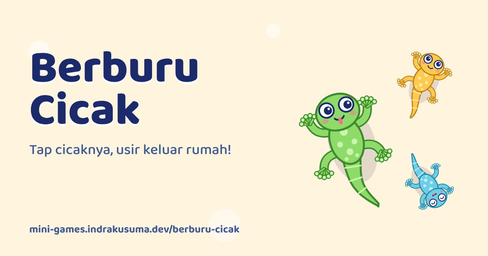

<div align="center">

<a href="https://mini-games.indrakusuma.dev/berburu-cicak/"></a>

# Berburu Cicak

**Tap cicaknya, usir keluar rumah!**

[▶️ Main sekarang](https://mini-games.indrakusuma.dev/berburu-cicak/) · Bagian dari [Taman Bermain](https://mini-games.indrakusuma.dev) · Dibuat oleh [Indra Kusuma](https://indrakusuma.dev)

</div>

## Tentang

Game tap cicak lucu untuk anak: latih ketangkasan jari dan fokus. Gratis, langsung main di browser tanpa install.

## Cara Main

1. Tekan **Main!** Cicak-cicak lucu mulai merayap di dinding rumah. Bunyinya "cek-cek-cek".
2. **Tap cicaknya.** Cicak kaget dan pusing sebentar, lalu pamit "Dadah!" dan pulang lewat jendela.
3. Usir 10 cicak sampai rumahnya bersih, lalu dapat 1 bintang ⭐.

Tidak ada waktu dan tidak ada kalah. Cicaknya tidak disakiti, cuma diusir pulang dengan cara yang lucu.

## Pengembangan

```bash
npm run dev               # dari root repo, lalu buka /berburu-cicak/
npm run berburu-cicak:images   # buat ulang thumbnail & ikon
```
