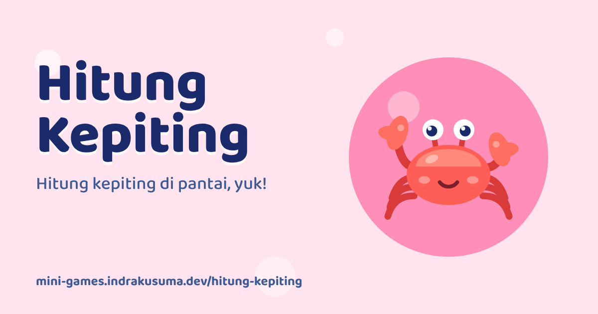

<div align="center">

<a href="https://mini-games.indrakusuma.dev/hitung-kepiting/"></a>

# Hitung Kepiting

**Hitung kepiting di pantai, yuk!**

[▶️ Main sekarang](https://mini-games.indrakusuma.dev/hitung-kepiting/) · Bagian dari [Taman Bermain](https://mini-games.indrakusuma.dev) · Dibuat oleh [Indra Kusuma](https://indrakusuma.dev)

</div>

## Tentang

Game belajar berhitung, penjumlahan, dan pengurangan bersama kepiting lucu untuk anak. Gratis, langsung main di browser tanpa install.

## Cara Main

1. Pilih permainan: **Hitung** (ada berapa kepiting?), **Tambah** (kepiting datang dari laut), atau **Kurang** (kepiting pulang ke laut).
2. Lihat kepitingnya. Sentuh kepiting satu per satu untuk menghitung: setiap kepiting mendapat nomor dan ikut disebutkan.
3. Sentuh angka yang benar dari tiga tombol besar. Salah? Tidak apa-apa, coba lagi!
4. Jawab 8 soal untuk mendapat 1 bintang ⭐. Angka sampai 10, mulai dari yang kecil dulu.

## Pengembangan

```bash
npm run dev               # dari root repo, lalu buka /hitung-kepiting/
npm run hitung-kepiting:images   # buat ulang thumbnail & ikon
```
