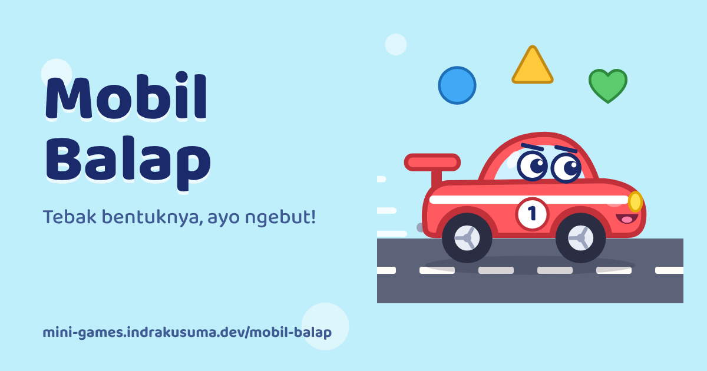

<div align="center">

<a href="https://mini-games.indrakusuma.dev/mobil-balap/"></a>

# Mobil Balap

**Tebak bentuknya, ayo ngebut!**

[▶️ Main sekarang](https://mini-games.indrakusuma.dev/mobil-balap/) · Bagian dari [Taman Bermain](https://mini-games.indrakusuma.dev) · Dibuat oleh [Indra Kusuma](https://indrakusuma.dev)

</div>

## Tentang

Game mobil balap untuk anak: tebak bentuk dan warna supaya mobil melaju sampai finis. Gratis, langsung main di browser tanpa install.

## Cara Main

1. Tekan **Main!** Mobil balap melaju dan berhenti di depan gerbang ❓.
2. Dengarkan pertanyaannya, misalnya "Mana segitiga biru?", lalu tekan bentuk yang cocok dari 3 pilihan. Tombol 🔊 mengulang pertanyaan.
3. **Benar:** palang terangkat, papan menampilkan bentuknya, dan mobil ngebut ke gerbang berikutnya. **Salah:** mobil mogok sebentar (asap dan batuk-batuk lucu), tombol yang salah jadi abu-abu, lalu anak boleh coba lagi. Setelah 2 kali salah, jawaban yang benar bergoyang sebagai petunjuk.
4. Lewati 6 gerbang sampai garis finis, lalu dapat 1 bintang ⭐.

Ada 5 bentuk (lingkaran, kotak, segitiga, bintang, hati) dan 4 warna (merah, biru, kuning, hijau). Dua gerbang pertama lebih mudah. Mulai gerbang ketiga, pengecohnya punya bentuk yang sama tapi warna lain, atau warna yang sama tapi bentuk lain, jadi anak perlu memperhatikan keduanya. Pertanyaan diucapkan dengan suara bawaan browser, jadi tidak ada file audio. Tidak ada waktu dan tidak ada game over.

## Pengembangan

```bash
npm run dev               # dari root repo, lalu buka /mobil-balap/
npm run mobil-balap:images   # buat ulang thumbnail & ikon
```
