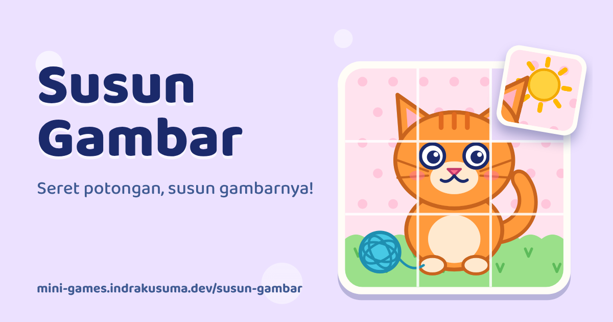

<div align="center">

<a href="https://mini-games.indrakusuma.dev/susun-gambar/"></a>

# Susun Gambar

**Seret potongan, susun gambarnya!**

[▶️ Main sekarang](https://mini-games.indrakusuma.dev/susun-gambar/) · Bagian dari [Taman Bermain](https://mini-games.indrakusuma.dev) · Dibuat oleh [Indra Kusuma](https://indrakusuma.dev)

</div>

## Tentang

Game puzzle 3x3 untuk anak: seret potongan gambar lucu ke tempatnya. Latih fokus dan logika. Gratis, langsung main di browser tanpa install.

## Cara Main

1. Tekan **Main!** Gambar lucu tampil utuh sebentar ("Ini gambar kucing. Ingat, ya!"), lalu pecah jadi 9 potongan di baki.
2. **Seret** setiap potongan ke tempatnya di papan 3x3. Papan punya bayangan samar gambarnya sebagai panduan. Anak juga bisa **tap potongan lalu tap kotaknya**.
3. Kalau pas, potongan menempel dengan bunyi *klik*. Kalau belum pas, potongan bergoyang lalu kembali ke baki, tanpa hukuman. Setelah 2 kali salah untuk potongan yang sama, kotak tujuannya bercahaya. Kalau anak diam beberapa saat, ada petunjuk jari yang memperlihatkan cara menyeret. Tombol 👀 menampilkan gambar utuh sebentar.
4. Kalau 9 potongan sudah terpasang, gambarnya utuh, namanya diucapkan, dan anak dapat 1 bintang ⭐.

Ada 8 gambar campuran: hewan (kucing, ikan, kura-kura, burung), kendaraan (kapal, pesawat), dan buah (semangka, stroberi). Gambar dipilih bergiliran tanpa berulang sampai semuanya keluar. Semua gambar digambar dengan canvas di `pictures.js`, jadi tidak ada file gambar.

## Pengembangan

```bash
npm run dev               # dari root repo, lalu buka /susun-gambar/
npm run susun-gambar:images   # buat ulang thumbnail & ikon
```
