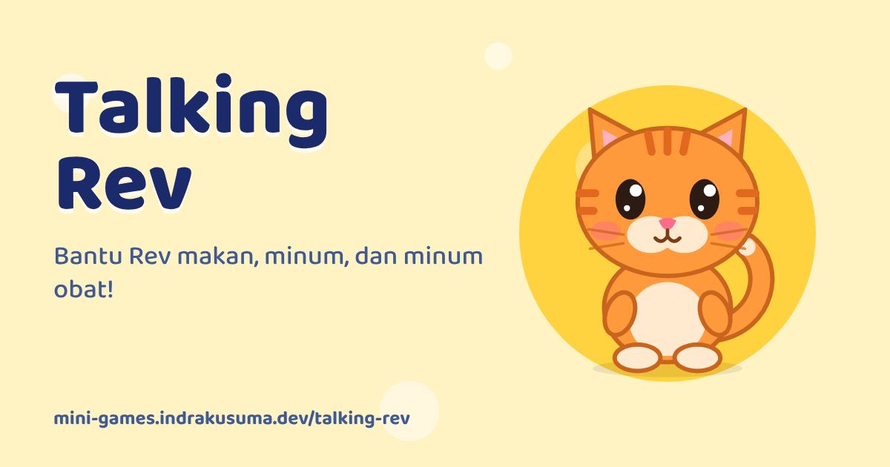

<div align="center">

<a href="https://mini-games.indrakusuma.dev/talking-rev/"></a>

# Talking Rev

**Bantu Rev makan, minum, dan minum obat!**

[▶️ Main sekarang](https://mini-games.indrakusuma.dev/talking-rev/) · Bagian dari [Taman Bermain](https://mini-games.indrakusuma.dev) · Dibuat oleh [Indra Kusuma](https://indrakusuma.dev)

</div>

## Tentang

Game merawat kucing Rev untuk anak: beri makan, minum air putih, dan belajar minum obat dengan benar. Gratis, langsung main di browser.

## Cara Main

1. Tekan **Main!** lalu sapa Rev, kucing oranye yang lucu.
2. Rev sedang **lapar**, **haus**, atau **sakit**. Lihat gelembung pikirannya, lalu pilih benda yang tepat: **Makan**, **Minum** (air putih), atau **Obat**. Kalau salah, Rev menjelaskan dengan lembut dan benda yang benar bergoyang sebagai petunjuk.
3. Saat Rev sakit, bantu dia minum obat langkah demi langkah: kocok botolnya, tuang ke sendok takar, suapkan, minum air putih, lalu ajak Rev istirahat sampai sembuh. Rev mengingatkan bahwa obat hanya boleh dari Ayah, Ibu, atau Dokter.
4. Elus kepala Rev (dia mendengkur) atau colek perutnya (dia kegelian). Tekan **🎤** lalu bicara: Rev menirukan suaramu dengan suara kucing. Suara hanya diproses di HP dan tidak dikirim ke mana pun. Tanpa izin mikrofon, semua bagian lain tetap bisa dimainkan.
5. Setelah ketiga kebutuhan Rev terpenuhi, kamu dapat 1 bintang.

## Pengembangan

```bash
npm run dev               # dari root repo, lalu buka /talking-rev/
npm run talking-rev:images   # buat ulang thumbnail & ikon
```
